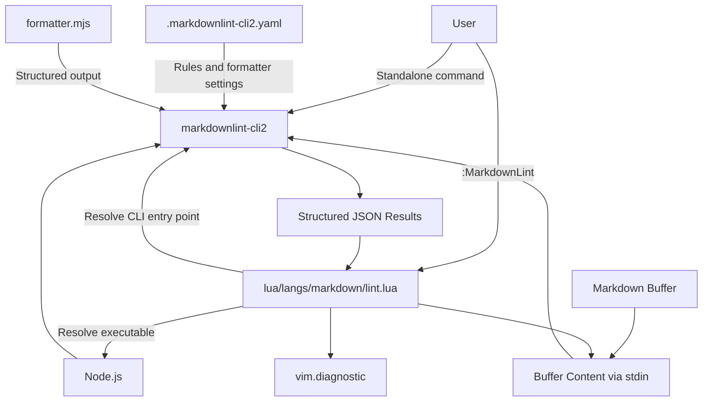
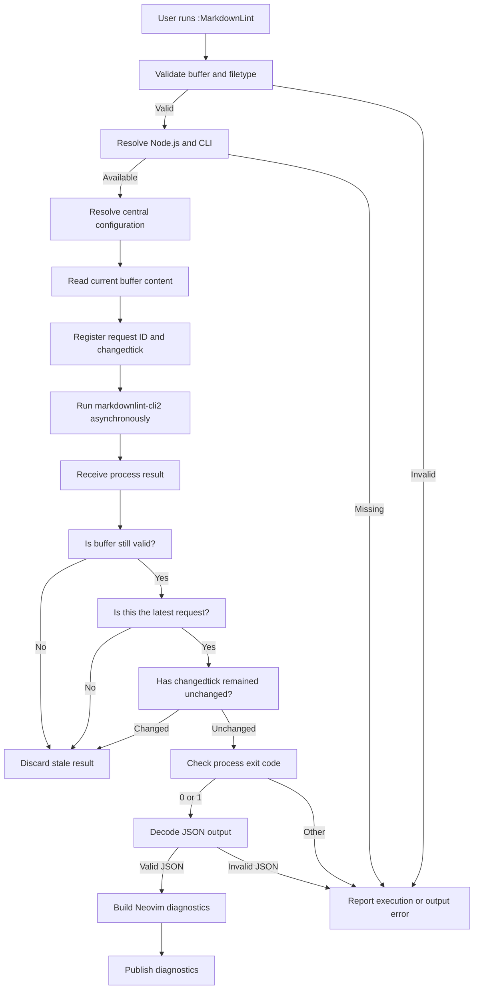

# Markdown Linting

## 1. Overview

The HETFS Neovim configuration provides an on-demand Markdown linting integration using [`markdownlint-cli2`](https://github.com/DavidAnson/markdownlint-cli2).

The integration applies a centrally maintained Markdown quality baseline to Markdown documents regardless of whether they are located inside or outside the Neovim configuration repository.

It supports two primary workflows:

- **Standalone linting:** Run `markdownlint-cli2` directly from a terminal.
- **Neovim linting:** Run `:MarkdownLint` against the current Markdown buffer, including unsaved changes.

The integration publishes structured lint results through Neovim's diagnostic API.

The design follows the project philosophy:

> Minimum installation. Compose the rest.

### Objectives

- Maintain one central Markdown linting policy.
- Support Markdown files across multiple projects.
- Lint unsaved buffer content without saving files.
- Produce structured JSON output for Neovim diagnostics.
- Preserve asynchronous execution.
- Reject stale results.
- Handle missing dependencies and execution failures explicitly.
- Avoid automatic linting and dependency installation.
- Keep linting independent of formatting and preview functionality.

## 2. Architecture

Markdown linting has four primary responsibilities:

1. **Configuration:** Defines the HETFS Markdown quality baseline.
2. **Execution:** Invokes markdownlint-cli2 using Node.js.
3. **Formatting:** Converts lint results into structured JSON.
4. **Diagnostics:** Converts JSON findings into Neovim diagnostics.

### Architecture diagram



### Component ownership

| Component | Responsibility |
|---|---|
| `.markdownlint-cli2.yaml` | Central lint configuration |
| `scripts/markdownlint/formatter.mjs` | Structured JSON formatter |
| `markdownlint-cli2` | Markdown lint engine |
| Node.js | JavaScript runtime |
| `lua/langs/markdown/lint.lua` | Neovim integration |
| `vim.diagnostic` | Diagnostic publication |
| `lua/config/keymaps.lua` | User-facing keymap registration |

The configuration, formatter, and Neovim integration have separate responsibilities. The formatter must not become responsible for buffer management, and the Neovim integration must not duplicate the Markdown linting rules.

## 3. Configuration

### 3.1 Central configuration

The central configuration file is:

```text
.markdownlint-cli2.yaml
```

It defines the HETFS Markdown quality baseline.

The configuration is maintained in the root of the Neovim configuration repository.

The Neovim integration must resolve this file independently of the current working directory and the location of the Markdown buffer.

This distinction is essential because Markdown files may belong to unrelated projects.

### 3.2 Configuration policy

The central configuration is the default policy for Markdown linting.

| Concern | Policy |
|---|---|
| Rule defaults | Enabled |
| Rule exceptions | Explicitly declared |
| Line length | Disabled |
| Heading validation | Enabled |
| List formatting | Consistent |
| Whitespace | Strictly validated |
| Fenced code blocks | Required |
| Code fence style | Backticks |
| Tables | Validated |
| Inline HTML | Permitted |
| JSON output | Required |

The configuration uses the `config` section for markdownlint rules and the top-level CLI2 options for execution and output formatting.

### 3.3 Structured output configuration

The configuration includes:

```yaml
noBanner: true
noProgress: true
showFound: false

outputFormatters:
  - - ./scripts/markdownlint/formatter.mjs
```

The custom formatter is part of the linting integration contract.

Neovim expects structured JSON rather than the default human-readable CLI summary.

The formatter path is relative to the configuration file. Consequently, the configuration must be resolved and passed explicitly when linting documents outside the repository.

### 3.4 Configuration resolution

Configuration resolution and project-root resolution are separate operations.

**Configuration path**

Resolves the centrally maintained `.markdownlint-cli2.yaml`.

**Project root**

Determines the working directory used by the lint process.

Do not assume that the Markdown file's directory is the location of the central configuration.

The following command demonstrates the required explicit configuration:

```powershell
$config = "C:\Users\Administrator\Desktop\nvim-config\.markdownlint-cli2.yaml"
$file = "C:\Users\Administrator\Desktop\myTest\Test-markdowon.md"

markdownlint-cli2 --config $config $file
```

This works even though the Markdown document is outside the configuration repository.

## 4. Execution architecture

### 4.1 Standalone execution

Users can invoke the CLI directly:

```powershell
markdownlint-cli2 path\to\document.md
```

When operating outside the configuration repository, explicitly provide the central configuration:

```powershell
markdownlint-cli2 --config $config $file
```

The standalone workflow uses the same lint rules and custom formatter as the Neovim integration.

This ensures consistent results across terminal and editor workflows.

### 4.2 Neovim execution

The Neovim integration is implemented in:

```text
lua/langs/markdown/lint.lua
```

The module exposes:

- `M.lint(bufnr)`
- `M.clear(bufnr)`
- `M.setup()`

The primary user-facing command is:

```vim
:MarkdownLint
```

Linting is manual and on demand. The integration does not automatically lint when a buffer opens, changes, or is saved.

### 4.3 Executable resolution

The integration checks for both:

- `node`
- `markdownlint-cli2`

It resolves the executable paths through Neovim's `vim.fn.exepath()`.

The implementation locates the markdownlint-cli2 Node.js entry point and executes it through Node.js.

This approach avoids depending on shell-specific command wrappers.

If Node.js, the CLI executable, or the expected entry point is unavailable, the integration reports an actionable error.

No dependency is installed automatically.

## 5. Unsaved-buffer support

The integration uses standard input rather than relying exclusively on the Markdown file on disk.

This is important because the user may have unsaved changes.

The execution process is:

1. Validate the buffer.
2. Read its current contents.
3. Preserve its end-of-file newline state.
4. Pass the contents through stdin.
5. Run markdownlint-cli2.
6. Decode the structured results.
7. Publish diagnostics.

The buffer is never saved automatically.

### Buffer-content handling

The implementation obtains buffer contents using:

```lua
local lines = vim.api.nvim_buf_get_lines(bufnr, 0, -1, false)
local content = table.concat(lines, "\n")

if vim.bo[bufnr].endofline then
  content = content .. "\n"
end
```

The `endofline` option is respected when constructing the stdin content.

This prevents the lint operation from requiring a disk write.

## 6. JSON formatter

The custom formatter is located at:

```text
scripts/markdownlint/formatter.mjs
```

Its responsibility is to produce structured lint findings that the Neovim integration can consume.

### 6.1 Output contract

The formatter output is expected to be a JSON array.

Each finding follows the markdownlint result structure, including fields such as:

| Field | Purpose |
|---|---|
| `fileName` | File associated with the finding |
| `lineNumber` | One-based line number |
| `column` | One-based column, when available |
| `length` | Finding length, when available |
| `severity` | Finding severity |
| `ruleNames` | Rule identifiers and aliases |
| `ruleDescription` | Human-readable rule description |
| `errorDetail` | Additional rule-specific information |
| `errorContext` | Relevant source context |

Example:

```json
[
  {
    "fileName": "README.md",
    "lineNumber": 9,
    "column": 1,
    "length": 2,
    "severity": "error",
    "ruleNames": [
      "MD018",
      "no-missing-space-atx"
    ],
    "ruleDescription": "No space after hash on atx style heading",
    "errorDetail": null,
    "errorContext": "#bad header"
  }
]
```

The example illustrates the expected result structure, not a requirement to reproduce a particular finding.

### 6.2 Output separation

The JSON output is a machine-readable interface.

Human-readable banners, progress messages, and diagnostic summaries must not be mixed into the JSON payload consumed by Neovim.

The formatter and CLI configuration must preserve this contract.

### 6.3 Empty results

A successful lint operation with no findings must produce an empty JSON array:

```json
[]
```

An empty array is a valid result. It must clear previously published diagnostics for the buffer.

### 6.4 Formatter failures

The integration must distinguish:

- Invalid JSON.
- Missing formatter.
- Missing configuration.
- CLI execution failure.
- Valid JSON containing lint findings.

A formatter failure must not be interpreted as a clean lint result.

## 7. Diagnostic integration

The integration publishes results using:

```lua
vim.diagnostic.set(namespace, bufnr, diagnostics)
```

The namespace is created once:

```lua
local namespace = vim.api.nvim_create_namespace("markdownlint-cli2")
```

This isolates Markdown lint diagnostics from other diagnostic providers.

### 7.1 Diagnostic mapping

The integration converts markdownlint results into Neovim diagnostic objects.

| markdownlint field | Neovim field |
|---|---|
| `lineNumber` | `lnum` |
| `column` | `col` |
| `length` | `end_col` |
| `severity` | `severity` |
| `ruleNames[1]` | `code` |
| `ruleDescription` | `message` |
| `errorDetail` | Additional message detail |
| `errorContext` | Additional message context |

markdownlint reports one-based line and column positions. Neovim diagnostics use zero-based positions.

The integration performs the required conversion and bounds-checks positions against the current buffer.

### 7.2 Severity mapping

| markdownlint severity | Neovim severity |
|---|---|
| `error` | `vim.diagnostic.severity.ERROR` |
| `warning` | `vim.diagnostic.severity.WARN` |

Unknown or absent severity values should be handled consistently with the integration's fallback policy.

### 7.3 Diagnostic clearing

The integration exposes:

```lua
M.clear(bufnr)
```

This operation:

- Invalidates any outstanding request for the buffer.
- Removes diagnostics belonging to the Markdown lint namespace.

It does not clear diagnostics from unrelated providers.

## 8. Asynchronous execution and stale-result protection

Linting runs asynchronously using `vim.system()`.

This prevents the editor from blocking while markdownlint-cli2 processes the document.

Multiple lint requests can occur for the same buffer. A previous request must not overwrite the results of a newer request.

### 8.1 Request tracking

The integration maintains:

- A request identifier for each buffer.
- A monotonically increasing request counter.
- The buffer's changedtick when the request begins.

Before publishing results, it verifies:

1. The buffer still exists.
2. The request is still the latest request for that buffer.
3. The buffer has not changed since the request started.

If any check fails, the result is discarded.

### 8.2 Execution-flow diagram



### 8.3 Invalid buffer handling

The integration checks that the buffer:

- Exists.
- Is loaded.
- Has the `markdown` filetype.

Invalid buffers and non-Markdown buffers are rejected before execution.

### 8.4 Buffer lifecycle

A `BufWipeout` autocmd removes outstanding request state for the buffer.

This prevents requests associated with destroyed buffers from being treated as current.

## 9. Exit-code handling

markdownlint-cli2 uses different exit codes for clean execution, lint findings, and execution failures.

The integration accepts:

| Exit code | Interpretation | Handling |
|---|---|---|
| `0` | Lint completed without errors | Decode and publish results |
| `1` | Lint completed with findings | Decode and publish findings |
| Other | Execution failure | Report an error |

Exit code `1` must not be treated as a process-launch failure.

This distinction is essential because lint findings are expected results, not exceptional execution failures.

## 10. Dependency management

Markdown linting requires:

| Dependency | Purpose |
|---|---|
| Node.js | Runtime |
| markdownlint-cli2 | Markdown lint engine |
| `formatter.mjs` | Structured JSON formatter |

The CLI and formatter are external dependencies of the Neovim integration.

They are not Neovim plugins.

### Dependency policy

- No Mason integration.
- No automatic npm installation.
- No automatic downloads.
- No implicit `npx` installation.
- No silent dependency upgrades.
- Explicit dependency verification.
- Explicit installation through the documented Windows dependency workflow.

The existing Windows dependency script is:

```text
scripts/core/windows/markdown-deps.ps1
```

Its responsibilities include checking the required Markdown CLI dependencies and supporting explicit installation of missing packages.

## 11. User workflow

### Standalone workflow

```powershell
$config = "C:\Users\Administrator\Desktop\nvim-config\.markdownlint-cli2.yaml"
$file = "C:\Users\Administrator\Desktop\myTest\Test-markdowon.md"

markdownlint-cli2 --config $config $file
```

This workflow applies the central HETFS Markdown rules to an external Markdown file.

### Neovim workflow

Open a Markdown file and execute:

```vim
:MarkdownLint
```

The integration reads the current buffer, including unsaved changes, and publishes the results.

The user can inspect findings through Neovim's diagnostic interface.

### Workflow characteristics

| Feature | Behavior |
|---|---|
| Trigger | Manual |
| Input | Current Markdown buffer |
| Unsaved changes | Supported |
| Execution | Asynchronous |
| Output | Structured JSON |
| Diagnostics | `vim.diagnostic` |
| Automatic saving | Disabled |
| Automatic installation | Disabled |
| Automatic lint-on-save | Disabled |

## 12. Testing and verification

Testing must cover both the standalone CLI and the Neovim integration.

### 12.1 Standalone verification

The following scenarios have been verified:

| Scenario | Result |
|---|---|
| Lint Markdown inside the configuration repository | Passed |
| Lint Markdown outside the configuration repository | Passed |
| Explicit central configuration using `--config` | Passed |
| Structured JSON output | Passed |
| Findings returned for invalid Markdown | Passed |
| Expected exit code `1` for lint findings | Passed |

The external test document used was:

```text
C:\Users\Administrator\Desktop\myTest\Test-markdowon.md
```

The test confirmed that the central configuration can be applied to documents outside the Neovim configuration directory.

The observed findings included:

- MD025: Multiple top-level headings.
- MD009: Trailing spaces.
- MD018: Missing space after an ATX heading marker.

The initial standalone invocation without the explicit configuration also reported MD013 line-length findings. Those findings were absent when the central configuration was loaded because that rule is intentionally disabled.

### 12.2 Neovim integration verification

The integration should retain coverage for:

| Test | Expected behavior |
|---|---|
| Valid Markdown buffer | Lint executes |
| Non-Markdown buffer | Request rejected |
| Invalid buffer | Request rejected |
| Unsaved buffer changes | Current content is linted |
| Buffer with no findings | Previous diagnostics cleared |
| Buffer with findings | Diagnostics published |
| Exit code `1` | Findings decoded successfully |
| Missing Node.js | Actionable error |
| Missing markdownlint-cli2 | Actionable error |
| Missing entry point | Actionable error |
| Invalid JSON | Formatter/output error |
| Changed buffer during execution | Result discarded |
| Superseded request | Older result discarded |
| Wiped buffer | Request state cleaned up |

The smoke test remains paused. Do not treat this document's test matrix as authorization to resume or execute it.

### 12.3 Test boundaries

Standalone verification and Neovim integration verification are separate.

A successful standalone CLI test does not, by itself, prove that unsaved-buffer handling, asynchronous execution, or diagnostic publication works correctly.

Each layer must be validated through its own tests.

## 13. Error handling

The integration should provide actionable messages for the following situations:

| Condition | Expected response |
|---|---|
| Node.js unavailable | Report missing Node.js |
| CLI unavailable | Report missing markdownlint-cli2 |
| Entry point unavailable | Report missing CLI entry point |
| Configuration unavailable | Report configuration resolution failure |
| Process cannot start | Report process-launch failure |
| Unsupported exit code | Report execution failure |
| Invalid JSON | Report output decoding failure |
| Invalid buffer | Warn and stop |
| Non-Markdown buffer | Warn and stop |

Error messages should identify the failing component without exposing unnecessary internal implementation details.

## 14. Design constraints

The following constraints are intentional and should remain part of the architecture.

### Centralized policy

The HETFS Markdown baseline is maintained centrally.

External Markdown files must not require a copy of the configuration simply to use the default linting policy.

### Separation of concerns

Markdown linting must remain separate from:

- Markdown formatting.
- Markdown rendering.
- Browser preview.
- Tree-sitter parsing.
- LSP diagnostics.

### No automatic behavior

Linting remains explicitly user-triggered.

No automatic linting, automatic saving, or dependency installation should be introduced without a separate architectural decision.

### Reliable asynchronous behavior

Request identifiers, changedtick validation, buffer validity checks, and cleanup are part of the integration's correctness contract.

They should not be removed as part of a simplification.

## 15. Acceptance criteria

Markdown linting is considered complete when the following requirements remain satisfied:

- [x] Central Markdown lint configuration exists.
- [x] Custom JSON formatter is configured.
- [x] Standalone linting works inside the configuration repository.
- [x] Standalone linting works outside the configuration repository.
- [x] Explicit central configuration loading works.
- [x] Structured JSON output is verified.
- [x] Lint findings are returned with the expected exit code.
- [x] Neovim integration supports stdin-based buffer linting.
- [x] Neovim diagnostics use a dedicated namespace.
- [x] Asynchronous execution is supported.
- [x] Stale-result protection is implemented.
- [x] Invalid buffers are handled safely.
- [x] Automatic linting is disabled.
- [x] Automatic dependency installation is disabled.

The acceptance checklist distinguishes implemented behavior from independently verified behavior. In particular, the standalone cross-project tests are confirmed; do not mark any additional test as passed without its own evidence.

## 16. References

- [markdownlint](https://github.com/DavidAnson/markdownlint)
- [markdownlint-cli2](https://github.com/DavidAnson/markdownlint-cli2)
- [markdownlint-cli2 v0.24.0](https://github.com/DavidAnson/markdownlint-cli2/tree/v0.24.0)
- [Neovim diagnostic API](https://neovim.io/doc/user/diagnostic.html)
- [Neovim system API](https://neovim.io/doc/user/lua.html#vim.system())

---

**Document status:** Markdown linting implementation documented.

**Project stage:** Stage 13 — Language Packs.

**Implementation policy:** Preserve the verified behavior and avoid unnecessary changes.
