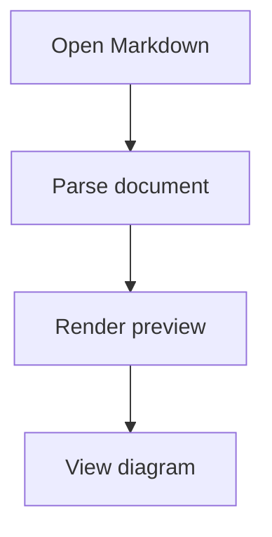

# Markdown Support

## 1. Purpose

This document defines the architecture, implementation, dependencies, workflow, and validation requirements for Markdown support in `nvim-config`.

Markdown is part of **Stage 13 — Language Packs** because project documentation is an essential development workflow. The implementation combines focused tools with distinct responsibilities rather than relying on one plugin to provide language intelligence, formatting, linting, syntax highlighting, table-of-contents generation, and visual rendering.

The implementation follows the repository's established philosophy:

> **Minimum installation. Compose the rest.**

The Markdown configuration must reuse existing language-pack, native LSP, formatter, Tree-sitter, dependency, and validation infrastructure. It must not introduce parallel systems for capabilities that the repository already provides.

This document is both an implementation specification and a living validation record. It distinguishes:

- Implemented functionality.
- Verified behavior.
- Configured but unverified functionality.
- Pending integration work.
- Optional extensions.
- Explicitly deferred work.

A configuration declaration alone does not establish that a dependency is installed or that its workflow works.

## 2. Scope and Status

### 2.1 Stage information

| Property | Value |
| --- | --- |
| Stage | 13 — Language Packs |
| Document status | Active implementation and validation record |
| Core implementation | In progress |
| Language pack | `lua/langs/markdown.lua` |
| Central configuration | `lua/config/languages.lua` |
| Default preview | `delphinus/md-render.nvim` |
| Default preview status | Accepted; target-environment validation reported as passed |

Stages 04, 10, and 12 are complete. They are not outstanding prerequisites for Markdown implementation and must not be treated as blockers.

### 2.2 Implementation status

| Component | Current status | Remaining work |
| --- | --- | --- |
| Markdown language pack | Implemented | Review metadata and run current regression checks |
| Central language configuration | Implemented | Verify current configuration contract |
| Tree-sitter `markdown` parser | Verified | Retain regression coverage |
| Tree-sitter `markdown_inline` parser | Verified | Retain regression coverage |
| Marksman | Declared and conditionally enabled | Verify executable, startup, and actual LSP attachment |
| Prettier | Declared as formatter | Verify executable and interactive `:Format` behavior |
| `markdownlint-cli2` | Integrated and interactively verified | Complete or retain fixture-level regression coverage |
| `:MarkdownToc` | CLI verified; Neovim integration pending | Verify package resolution, execution, buffer updates, and failure handling |
| `markdown-deps.ps1` | Management contract specified | Validate execution on Windows |
| `md-render.nvim` | Accepted default baseline | Preserve compatibility evidence and record exact revision |
| `render-markdown.nvim` | Optional in-buffer renderer | Evaluate independently if selected |
| `markdown-preview.nvim` | Independent optional browser preview | Evaluate independently if selected |
| Mermaid | Default diagram format | Verify renderer integration |
| D2 | Optional diagram format | Evaluate only when needed |
| archDraw | Optional specialized diagram format | Evaluate only when needed |
| Japanese phrase segmentation | Optional capability | Validate optional `budoux.lua` integration if selected |

### 2.3 Completion policy

Markdown support must not be marked complete until the required core implementation, dependency documentation, automated checks, and interactive validation have passed.

Keep three completion boundaries separate:

1. **Core Markdown support:** Language intelligence, formatting, linting, syntax parsing, and TOC generation.
2. **Default rendering:** The accepted `md-render.nvim` baseline and its required compatibility behavior.
3. **Optional extensions:** Alternative in-buffer rendering, browser preview, additional diagram formats, and Japanese phrase segmentation.

Completing one boundary does not automatically complete the others.

Optional extensions must not block core Markdown completion.

## 3. Design Principles

The implementation follows these principles:

- Prefer Neovim's built-in capabilities where they adequately satisfy the requirement.
- Separate language intelligence, formatting, linting, syntax highlighting, TOC generation, and rendering.
- Use native `vim.pack` for explicitly admitted plugins.
- Keep external executables separate from Neovim plugin installation.
- Follow the existing language-pack architecture and centralized user configuration.
- Reuse shared LSP, formatter, parser, dependency, and validation infrastructure.
- Preserve manual formatting: no format-on-save by default.
- Preserve the existing LSP formatting contract: no automatic LSP formatting fallback by default.
- Keep linting independent of formatting.
- Keep rendering independent of the core Markdown editing workflow.
- Keep preview activation under explicit user control.
- Do not introduce a plugin when an existing executable and shared infrastructure provide the required functionality.
- Distinguish proposed tools, admitted dependencies, configured components, and verified workflows.
- Avoid duplicate ownership of the same responsibility.
- Do not silently download executables, renderer binaries, or packages.
- Keep optional dependencies outside the core installation profile.
- Validate actual behavior rather than relying on plugin documentation or configuration declarations alone.

## 4. Markdown Architecture

### 4.1 Responsibility boundaries

Markdown support is composed of independent components.

| Component | Responsibility |
| --- | --- |
| Markdown language pack | Coordinates Markdown-specific integrations |
| Tree-sitter | Markdown syntax parsing and highlighting |
| Marksman | Markdown language intelligence |
| Prettier | Markdown source formatting |
| `markdownlint-cli2` | Markdown style and consistency checks |
| `markdown-toc` | On-demand table-of-contents generation |
| `md-render.nvim` | Default in-editor Markdown rendering |
| `render-markdown.nvim` | Optional alternative in-buffer rendering |
| `markdown-preview.nvim` | Independent optional browser preview |
| Mermaid | Default diagram format |
| D2 | Optional diagram format |
| archDraw | Optional specialized cloud infrastructure diagrams |
| `budoux.lua` | Optional Japanese phrase segmentation |

These components are complementary, not interchangeable.

Marksman provides language intelligence rather than visual rendering. Prettier formats source text rather than displaying a preview. `markdownlint-cli2` checks source against a rule policy rather than replacing the formatter. Tree-sitter provides syntax parsing and highlighting rather than a complete rendered document.

TOC generation is an explicit command and does not depend on preview rendering.

The core Markdown editing workflow must remain usable without any preview plugin or optional rendering dependency.

### 4.2 Directory architecture

The Markdown language pack owns Markdown-specific language integrations. Preview plugins belong to the Markdown plugin group rather than being embedded in the language pack.

The intended organization is:

```text
lua/
├── config/
│   ├── languages.lua
│   └── keymaps.lua
│
├── langs/
│   ├── markdown.lua
│   └── markdown/
│       └── toc.lua
│
└── plugins/
    ├── treesitter.lua
    └── markdown/
        ├── md-render.lua
        ├── render-markdown.lua
        └── markdown-preview.lua
```

Responsibilities:

- `lua/langs/markdown.lua`: Markdown language-pack metadata and explicit setup.
- `lua/langs/markdown/toc.lua`: TOC command and external CLI integration.
- `lua/plugins/treesitter.lua`: Shared parser installation and highlighting infrastructure.
- `lua/plugins/markdown/md-render.lua`: Default in-editor renderer configuration.
- `lua/plugins/markdown/render-markdown.lua`: Optional alternative in-buffer renderer.
- `lua/plugins/markdown/markdown-preview.lua`: Optional browser-preview configuration.
- `lua/config/languages.lua`: Central language-pack enablement and existing formatter preferences.
- `lua/config/keymaps.lua`: User-facing Markdown mappings.

The three preview modules must remain independent. The presence of one module must not automatically install, configure, or activate another.

Do not introduce a separate Markdown loader or duplicate the shared language infrastructure.

### 4.3 Language-pack metadata

The Markdown language pack lives in:

`lua/langs/markdown.lua`

It declares metadata consumed by existing shared infrastructure:

| Metadata | Markdown value |
| --- | --- |
| Primary parser | `markdown` |
| Parser dependency | `markdown_inline` |
| Formatter | `prettier` |

The pack uses the existing metadata fields:

- `formatters`
- `parser_by_filetype`
- `parser_dependencies_by_filetype`

Marksman, linting, and TOC generation are initialized through the pack's explicit `setup()` implementation.

Do not introduce `servers` or `executables` metadata unless a shared consumer is implemented and validated.

The TOC integration is resolved by `lua/langs/markdown/toc.lua`. It is an external CLI workflow, not an installation responsibility of Neovim or the language registry.

### 4.4 Shared infrastructure

Reuse the existing infrastructure for:

- Discovering and enabling language packs.
- Registering and enabling language servers through native LSP APIs.
- Collecting formatter and parser metadata.
- Resolving preferred and exclusive formatters where supported.
- Reporting missing external executables.
- Validating metadata and user configuration.
- Preserving existing startup and error-handling behavior.

The Markdown pack must not introduce a separate formatter framework, language loader, dependency installer, or preference system.

### 4.5 Central configuration

User-facing language configuration belongs in:

`lua/config/languages.lua`

The Markdown pack must be enabled through this centralized configuration.

Formatter preferences and exclusive formatter selections must use existing configuration fields.

Lint configuration must follow the repository's established configuration ownership conventions. Avoid creating an independent preference system solely for Markdown.

## 5. Markdown Syntax and Authoring Profiles

Markdown support uses CommonMark as its portable syntax foundation and GitHub Flavored Markdown (GFM) as the default documentation authoring profile.

These are related but distinct specifications.

### 5.1 CommonMark

Official specification:

https://spec.commonmark.org/current/

CommonMark defines the portable syntax foundation for Markdown documents.

The implementation and rendering tests must cover:

- ATX headings.
- Setext headings.
- Paragraphs.
- Soft and hard line breaks.
- Thematic breaks.
- Blockquotes.
- Ordered and unordered lists.
- Nested lists.
- Indented code blocks.
- Fenced code blocks.
- Inline code.
- Emphasis and strong emphasis.
- Links and images.
- Autolinks.
- Raw HTML.
- Backslash escapes.
- Character references.

CommonMark compatibility must be tested independently of GFM extensions.

### 5.2 GitHub Flavored Markdown

Official specification:

https://github.github.com/gfm/

GFM is the default authoring profile for repository documentation.

The required GFM extensions are:

- Tables.
- Task lists.
- Strikethrough.
- Bare URL and email autolinks.
- Disallowed raw HTML tag filtering.

Do not claim full GFM compatibility based only on tables and task lists.

GitHub-specific features such as alerts and issue or pull-request references must be treated separately from formal GFM syntax.

### 5.3 Optional syntax extensions

The following are optional and must not become core dependencies without a demonstrated requirement:

- Footnotes.
- Mathematical notation.
- Additional diagram formats.
- Platform-specific GitHub extensions.

Syntax support, editor rendering, source editing, and platform rendering are separate capabilities. A feature supported by one renderer must not be assumed to work identically in another.

### 5.4 Compatibility fixtures

Maintain separate CommonMark and GFM fixtures.

The CommonMark fixture should cover the portable syntax elements in Section 5.1.

The GFM fixture should cover all required GFM extensions.

Optional extensions should have separate fixtures so their absence does not make core compatibility tests fail.

## 6. Tree-sitter Integration

Tree-sitter provides Markdown syntax parsing and highlighting through the existing shared integration:

`lua/plugins/treesitter.lua`

### 6.1 Parser metadata

The Markdown pack declares:

- Primary parser: `markdown`.
- Additional parser: `markdown_inline`.

The shared Tree-sitter integration collects both metadata fields from enabled language packs.

It validates parser mappings and dependency lists before registering its `FileType` autocmd.

The primary parser is installed and started for Markdown highlighting. Additional parsers are installed as dependencies without being started as the buffer's primary parser.

### 6.2 Installation behavior

The existing integration:

- Reuses an available parser.
- Requests installation of a missing parser through `nvim-treesitter`.
- Tracks pending installations to avoid duplicate requests.
- Associates waiting buffers with the parser being installed.
- Starts highlighting only for buffers that requested the parser as their primary parser.
- Checks that buffers remain valid and retain the expected filetype before starting highlighting.
- Reports installation and highlighting failures through Neovim notifications.

Parser installation is asynchronous. Installing a dependency parser must not start it as the buffer's primary parser.

External compiler and archive-tool requirements must remain part of the repository's existing platform dependency management.

### 6.3 Validation

Verify that:

1. Markdown files receive the expected `markdown` filetype.
2. Both parsers are available and load successfully.
3. Missing parsers use the existing asynchronous installation path.
4. Primary-parser highlighting starts for Markdown buffers.
5. Additional parser dependencies are installed without becoming primary parsers.
6. Invalid parser metadata fails clearly.
7. Existing Windows compiler and archive-tool setup remains intact.
8. Visible highlighting works in an interactive Neovim session.

A passing configuration smoke test does not prove that every parser is installed or that highlighting behaves correctly.

Do not add another Markdown syntax-highlighting plugin to duplicate the existing Tree-sitter responsibility without a demonstrated requirement and a separate admission decision.

## 7. Markdown Language Server

**Implementation target:** Marksman.

Repository:

https://github.com/artempyanykh/marksman

Marksman provides Markdown language intelligence, including supported link completion, navigation, references, and diagnostics.

The Markdown pack declares the Marksman server and its executable. Its setup checks executable availability before enabling the server through Neovim's native LSP API.

### 7.1 Implementation requirements

- Keep Marksman activation within the Markdown language pack.
- Reuse the existing native LSP architecture and server definitions.
- Use Neovim's native LSP APIs.
- Do not introduce a separate Markdown-specific LSP loader.
- Manage the Marksman executable independently of plugin installation.
- Verify the server identifier and definition against the installed configuration.
- Test individual Markdown files and project workspaces.
- Test internal links, heading navigation, references, and diagnostics where applicable.
- Document verified installation and executable requirements in `docs/dependencies.md`.
- Distinguish missing executables from successful server startup.

Marksman's project-wide features may depend on workspace-root detection, repository context, or a `.marksman.toml` marker.

Verify the actual behavior rather than assuming that every Markdown file has the same workspace context.

Do not introduce a second project-root detection mechanism solely for Markdown. Reuse existing root-detection behavior where compatible and document any verified Marksman-specific requirements.

### 7.2 Validation

Verify that:

1. The Marksman server definition is available.
2. The executable is detected correctly.
3. The server starts and attaches when its executable and configuration are available.
4. Missing executables are reported clearly.
5. Link navigation and other supported features work in a representative Markdown project.
6. Individual files and project files produce understandable workspace behavior.
7. Workspace-root behavior is tested rather than inferred.
8. Existing LSP behavior and other language packs remain unaffected.

Automated checks should validate the configuration contract without requiring a live server process. Interactive verification must establish actual startup and attachment.

**Current status:** Declared and conditionally enabled. Interactive LSP attachment verification remains outstanding.

## 8. Markdown Formatting

**Formatter:** Prettier.

Documentation:

https://prettier.io/docs

Formatting uses the existing manual interface through `:Format` and Conform.

### 8.1 Implementation requirements

- Register Prettier through Markdown formatter metadata.
- Preserve the existing formatter-resolution contract.
- Validate preferred and exclusive formatter overrides through shared configuration.
- Report unavailable formatter executables clearly.
- Keep format-on-save disabled by default.
- Keep LSP formatting fallback disabled by default.
- Keep formatting independent of linting and preview rendering.
- Manage formatter installation and runtime requirements separately from Neovim plugin installation.

Do not introduce a Markdown-only formatter preference mechanism.

### 8.2 Validation

Format representative documents containing:

- Headings and paragraphs.
- Ordered and unordered lists.
- Tables.
- Inline links and reference links.
- Fenced code blocks.
- Inline code and emphasis.
- Long paragraphs and nested content.

Confirm that `:Format` invokes the intended formatter and produces expected output.

Also verify that:

1. Formatting remains an explicit user action.
2. Format-on-save has not been enabled inadvertently.
3. LSP formatting is not silently used as a fallback.
4. Formatter selection respects shared configuration.
5. Other filetypes retain their existing formatter behavior.

**Current status:** Prettier is declared in formatter metadata. Interactive executable and `:Format` verification remain outstanding.

## 9. Markdown Linting

**Linter:** `markdownlint-cli2`

Repository:

https://github.com/DavidAnson/markdownlint-cli2

Linting is part of the current Stage 13 implementation.

It is not deferred to a separate future stage.

### 9.1 Responsibility

Formatting and linting are independent operations:

- Prettier formats Markdown source.
- `markdownlint-cli2` checks Markdown against an explicit rule policy.

The linter uses the existing external-tool and language-pack conventions. A dedicated Neovim lint plugin is not required unless the existing infrastructure cannot provide the necessary workflow.

### 9.2 Implementation requirements

- Use `markdownlint-cli2` as the Markdown lint executable.
- Keep installation independent of Neovim plugin installation.
- Define the lint command and invocation in the existing tooling architecture.
- Version-control the lint configuration and document its rule policy.
- Report findings with useful file and line information.
- Distinguish rule violations from executable failures and invalid configuration.
- Report missing executables clearly.
- Support the current Markdown file and, where practical, project-level linting.
- Keep linting independent of `:Format`.
- Do not silently lint on save without a separate explicit decision.
- Do not make linting a prerequisite for opening or editing Markdown files.

### 9.3 Configuration policy

Use the repository's established configuration conventions.

The lint rule configuration must be version-controlled. Rule changes must be intentional and validated against representative fixtures.

Avoid a separate Markdown-only preference system or duplicate shared tool management.

### 9.4 Implementation and validation record

**Status: Integrated and interactively verified.**

The current integration:

- Uses stdin so unsaved buffer contents are linted.
- Produces structured JSON through a custom formatter.
- Publishes findings through `vim.diagnostic`.

Verified behavior:

- The `markdownlint-cli2` command shim produced valid JSON (`[]`) for clean input, with exit code `0` and empty stderr.
- Direct execution through the Node.js CLI entrypoint produced the same result.
- The custom formatter and `.markdownlint-cli2.yaml` configuration loaded successfully in direct CLI tests.
- The Neovim `:MarkdownLint` command passed for a named Markdown buffer.
- Project-root discovery found the repository configuration when Neovim's working directory was outside the repository.
- Exit code `1` is accepted for lint findings and distinguished from execution failures.
- Unsaved-buffer input, diagnostic publication, stale-result handling, malformed JSON, and missing-dependency paths were exercised.

An unnamed buffer has no file path from which to discover a repository root. The current implementation falls back to Neovim's working directory.

A clearer unnamed-buffer root policy is a follow-up improvement, not a blocker for the verified named-file workflow.

### 9.5 Fixture coverage

Retain fixtures covering:

- Valid Markdown.
- Heading hierarchy violations.
- List formatting violations.
- Trailing whitespace.
- Blank-line violations.
- Link and code-block formatting.
- Explicitly documented rule exceptions.

Continue to verify:

1. Valid fixtures pass.
2. Invalid fixtures produce expected diagnostics.
3. Diagnostics contain useful file and line information.
4. Missing executables produce actionable errors.
5. Invalid configuration produces clear errors.
6. Linting does not modify source files.
7. Formatting and linting remain independent.
8. Other language packs and tooling do not regress.

Do not assume Prettier resolves every lint rule. Where their rules overlap, document the intended policy and ensure that formatting and linting do not produce an endless cycle.

## 10. Markdown Table of Contents

**CLI package:** `@frat/markdown-toc` v1.3.0
**Executable:** `markdown-toc`

The TOC integration belongs to:

`lua/langs/markdown/toc.lua`

It is exposed through the explicit `:MarkdownToc` user command and initialized by the Markdown pack's existing `setup()` function.

### 10.1 Behavior and ownership

The command must:

- Operate on the current Markdown buffer, including unsaved changes.
- Use `<!-- toc -->` and `<!-- tocstop -->` as boundaries.
- Run the CLI against a temporary Markdown file.
- Update the buffer only after successful CLI execution.
- Avoid automatic saving.
- Avoid automatic generation on startup, buffer entry, or save.
- Avoid automatic package installation.
- Report missing executables, invalid markers, and process failures.
- Reject stale asynchronous results.
- Remain independent of linting, formatting, LSP, and preview rendering.

The module resolves `node` and `markdown-toc` through Neovim's PATH, then locates the Node entrypoint from the npm global package layout.

It supports the original `markdown-toc` package and the maintained `@frat/markdown-toc` fork.

Package resolution must be verified inside Neovim on the target Windows environment.

### 10.2 CLI validation record

The selected package was installed globally:

```powershell
npm install --global @frat/markdown-toc
```

The executable reported version `v1.3.0` in PowerShell.

Its help output confirmed file input, stdin input, and `-i` in-place marker-based generation.

A temporary-file test confirmed that the CLI generated a nested TOC between the configured markers. Running it a second time produced identical content, confirming CLI-level idempotency.

This verifies the external CLI in PowerShell. It does not verify package resolution, process execution, command registration, or buffer updates inside Neovim.

### 10.3 Neovim validation

Verify that:

1. `:MarkdownToc` is registered when the Markdown pack is enabled.
2. A valid Markdown buffer receives the generated TOC.
3. Unsaved buffer content is included.
4. Repeated generation does not duplicate entries.
5. The buffer becomes modified when output changes.
6. The file is not saved automatically.
7. Missing, duplicated, or incorrectly ordered markers produce clear warnings.
8. Missing Node.js or `markdown-toc` produces actionable errors.
9. The command works with `@frat/markdown-toc` on Windows + WezTerm.
10. Edits made while generation is running are not overwritten by stale results.
11. Wiped buffers and superseded requests are handled safely.
12. Non-modifiable buffers are not changed.
13. Temporary files are removed after success, failure, or superseded requests.
14. The original buffer's `endofline` setting is preserved.
15. No automatic TOC generation or dependency installation occurs.

**Current status:** CLI generation and idempotency verified in PowerShell. Neovim integration remains pending interactive validation.

## 11. Markdown Rendering and Preview

Rendering is separate from the core Markdown editing workflow.

The architecture distinguishes three preview roles:

| Plugin | Role | Installation profile |
| --- | --- | --- |
| `delphinus/md-render.nvim` | In-editor rendering baseline | Default |
| `render-markdown.nvim` | Alternative in-buffer rendering | Optional |
| `markdown-preview.nvim` | Browser-based live preview | Independent optional extension |

These implementations must not be treated as interchangeable.

### 11.1 Shared preview policies

Preview plugins must:

- Use native `vim.pack`.
- Have independent configuration modules.
- Keep activation under explicit user control.
- Avoid automatic rendering during startup or buffer opening.
- Avoid automatically opening a browser.
- Document external dependencies and installation procedures.
- Avoid silent downloads and implicit package installation.
- Have independent tests and failure handling.
- Remain independent of Marksman, formatting, and linting.
- Fail without damaging ordinary Markdown editing.

Installing a preview plugin does not authorize it to start a preview, open a browser, render a document, or download additional software.

Separate the following operations:

1. **Installation:** The plugin becomes available locally through the selected installation profile.
2. **Configuration loading:** The plugin configuration prepares options and commands without starting a preview.
3. **Activation:** The user explicitly requests rendering through the plugin's documented command or mapping.

Only one in-buffer renderer should be active by default.

### 11.2 Default baseline: `md-render.nvim`

Repository:

https://github.com/delphinus/md-render.nvim

**Status: Accepted.**

`md-render.nvim` is the default in-editor Markdown renderer.

It provides rendering inside Neovim and is the selected baseline because it keeps the preview within the editor workflow and supports the required CommonMark and CJK-oriented behavior.

Its required capabilities include:

- In-editor Markdown rendering.
- Mermaid diagrams rendered as inline images.
- CommonMark soft-break handling.
- Correct paragraph continuation inside list items and blockquotes.
- CJK-aware paragraph joining without unintended spaces.
- CJK-aware line wrapping, including documented kinsoku behavior.
- Optional Japanese phrase segmentation.

The exact feature set must be checked against the installed plugin revision. Do not infer support for every optional renderer feature from the plugin's general documentation.

#### Compatibility environment

The reported validation environment is:

- Windows.
- Neovim 0.12.6.
- WezTerm `20240203-110809-5046fc22`.

The user reported that `md-render.nvim` validation passed in this environment.

This target-environment result, rather than upstream platform claims alone, is the basis for accepting the plugin as the default baseline.

Preserve the exact plugin revision and detailed test evidence in `docs/plugin-inventory.md` when available.

#### Dependencies

Identify dependencies by the feature that requires them.

| Dependency | Purpose | Policy |
| --- | --- | --- |
| Terminal graphics support | Displays rendered images inside Neovim | Validate on Windows + WezTerm |
| `curl` | Retrieves remote media where enabled | External dependency; install explicitly |
| Mermaid CLI (`mmdc`) | Renders Mermaid diagrams | Explicitly manage if selected |
| D2 | Renders D2 diagrams | Optional |
| archDraw | Produces specialized infrastructure diagrams | Optional |
| `budoux.lua` | Japanese phrase segmentation | Optional |
| FFmpeg and `ffprobe` | Media conversion and video-related features | Optional |
| ImageMagick | Image conversion fallback where supported | Optional |

The actual required set depends on the admitted feature set. Optional media dependencies must not become mandatory for basic Markdown preview.

Do not permit implicit `npx` or package-manager fallback to download Mermaid CLI or other packages.

If a required executable is missing, report the missing dependency and explain how to install it explicitly.

#### Japanese phrase segmentation

Japanese phrase segmentation is an optional presentation enhancement.

`budoux.lua` remains an optional dependency for Japanese phrase segmentation. It is not part of the core Markdown requirement.

The integration must:

- Remain independently selectable.
- Avoid becoming a mandatory dependency of the default Markdown setup.
- Preserve normal wrapping when segmentation is unavailable or disabled.
- Avoid modifying the Markdown source.
- Keep its behavior separate from core Markdown parsing and editing.

Validate the renderer with segmentation both enabled and disabled when the optional feature is selected.

#### Preview mappings

User-facing mappings live in `lua/config/keymaps.lua`:

```lua
vim.keymap.set("n", "<leader>mp", "<Plug>(md-render-preview)", {
  desc = "Markdown preview",
})

vim.keymap.set("n", "<leader>mt", "<Plug>(md-render-preview-tab)", {
  desc = "Markdown preview in tab",
})

vim.keymap.set("n", "<leader>md", "<Plug>(md-render-demo)", {
  desc = "Markdown render demo",
})
```

These mappings preserve manual activation.

The plugin must not automatically open a preview during startup or buffer entry.

#### Compatibility regression checks

Retain checks for:

1. Exact repository and plugin revision.
2. Loading through native `vim.pack`.
3. Compatibility with the target Neovim version.
4. Basic rendering on Windows + WezTerm.
5. Image rendering in the actual terminal.
6. Mermaid diagrams rendered as inline images.
7. CommonMark soft breaks.
8. List-item continuation lines.
9. Blockquote continuation lines.
10. CJK paragraph joining without unintended spaces.
11. CJK line wrapping and documented kinsoku behavior.
12. Optional Japanese segmentation behavior.
13. Actionable missing-dependency diagnostics.
14. No unapproved downloads.
15. Reliable preview closing and reopening.
16. Source-buffer integrity after preview failures.

Record the plugin revision, Neovim version, Windows environment, WezTerm version, terminal graphics behavior, dependency versions, and test results.

### 11.3 Optional alternative: `render-markdown.nvim`

Repository:

https://github.com/MeanderingProgrammer/render-markdown.nvim

`render-markdown.nvim` is an optional alternative for in-buffer Markdown rendering.

It is not the default baseline and must not silently replace `md-render.nvim`.

Evaluate it independently if there is a demonstrated requirement that the baseline does not satisfy.

The evaluation must consider:

- Plugin revision and native `vim.pack` integration.
- Rendering quality and supported Markdown features.
- Buffer interaction and editing behavior.
- Performance on representative documents.
- External dependencies.
- Compatibility with the target Windows and terminal environment.
- Interaction with the default renderer.
- Manual activation and predictable cleanup.

Do not enable both in-buffer renderers by default.

Record one of the following decisions:

- **Accepted:** The alternative provides a distinct, useful capability and can be managed reliably.
- **Deferred:** The evaluation identifies useful capabilities but requires more investigation.
- **Rejected:** The implementation introduces unacceptable complexity, instability, or duplication.

The optional alternative does not block core Markdown support or the accepted default baseline.

### 11.4 Independent optional extension: `markdown-preview.nvim`

Repository:

https://github.com/sammaji/markdown-preview.nvim

Installation documentation:

https://mkdp.sammaji.com/installation

`markdown-preview.nvim` provides a browser-based preview workflow. It is not an in-buffer terminal renderer.

It remains an independent optional extension and must not be confused with either `md-render.nvim` or `render-markdown.nvim`.

Its absence must not affect core Markdown editing or the default in-editor preview.

#### Installation and dependency policy

The maintained fork documents a prebuilt Windows x64 server binary and an explicit installation procedure.

Before admitting the extension:

- Verify the exact repository and revision.
- Verify the Windows x64 server binary.
- Determine how the binary will be installed and updated explicitly.
- Verify native `vim.pack` integration.
- Confirm that preview startup does not trigger an unapproved installation.
- Document browser and server requirements.
- Keep its installation separate from the default baseline.

Do not add an automatic Neovim startup installer.

#### Isolated evaluation

Evaluate the extension independently in a temporary checkout and clean Neovim session.

Verify:

1. Plugin loading without errors.
2. Preview opening in the selected browser.
3. Ordinary Markdown rendering.
4. Tables, task lists, links, callouts, and fenced code blocks.
5. Local image resolution.
6. Remote image behavior when network access is available.
7. Mathematical notation and supported diagrams.
8. Preview updates after source edits.
9. Synchronized scrolling.
10. Reliable closing and reopening.
11. Browser and server process cleanup.
12. Source integrity.
13. Failure isolation from ordinary editing.
14. No unapproved downloads when server binaries are missing.

Record the plugin revision, server version, Neovim version, Windows environment, browser, test results, and relevant errors.

#### Optional admission decision

Record one of the following:

- **Accepted:** Browser preview works reliably and dependencies can be managed explicitly.
- **Deferred:** Useful features work, but compatibility or stability needs further investigation.
- **Rejected:** The extension cannot meet requirements without unacceptable complexity or instability.

A deferred or rejected browser-preview extension does not invalidate the default in-editor preview or core Markdown language pack.

### 11.5 Diagram support

Mermaid is the baseline diagram format.

D2 and archDraw are optional extensions with independent dependencies and admission decisions.

#### Mermaid

Official documentation:

https://mermaid.js.org/

Mermaid is the default diagram format for Markdown documentation.

Verify that the selected renderer displays Mermaid as a visual diagram rather than an unprocessed code block.

For `md-render.nvim`, verify inline image rendering using an explicitly managed Mermaid CLI installation.

For browser preview, verify the extension's documented Mermaid behavior separately.

Representative fixture:



#### D2

Official documentation:

https://d2lang.com/

D2 is optional.

Evaluate it only when the project needs capabilities that Mermaid does not adequately provide.

Verify:

- Explicit installation and version management.
- Renderer compatibility.
- Image output in the selected preview environment.
- Clear behavior when the executable is unavailable.
- No implicit package installation.

#### archDraw

archDraw is an optional specialized diagram capability for cloud infrastructure maps.

It must not become a mandatory Markdown dependency.

Evaluate its renderer, external requirements, output format, and compatibility independently before admission.

### 11.6 Shared rendering fixtures

Use shared Markdown fixtures to compare rendering behavior without requiring identical rendering engines or presentation.

Fixtures should include:

- Ordinary paragraphs.
- Soft line breaks.
- Nested lists and continuation lines.
- Blockquotes.
- Tables.
- Links.
- Fenced code blocks.
- Local and remote images.
- Mermaid diagrams.
- Mathematical notation where supported.
- Japanese paragraphs.
- Chinese paragraphs.
- Mixed CJK and Latin text.

#### CommonMark paragraph behavior

```markdown
This is a paragraph
that continues on another source line
without creating a new paragraph.

- First list item
  with a continuation line
  that belongs to the same item.

> This is a blockquote
> continued on another source line.
```

Verify that:

- Soft-wrapped source lines join into the same paragraph.
- Blank lines still separate paragraphs.
- List continuation lines remain part of the same list item.
- Blockquote continuation lines remain inside the blockquote.
- Rendering does not introduce unintended paragraph boundaries.

#### CJK paragraph and wrapping behavior

```markdown
これは日本語の文章です。
次の行も同じ段落に続きます。

这是一个中文段落。
下一行继续同一个段落。

Mixed text: 日本語とEnglishが同じ段落にあります。
```

Verify that paragraph joining does not insert unintended spaces between CJK characters and that line wrapping follows the renderer's documented behavior.

The baseline `md-render.nvim` evaluation must cover its required CJK behavior. Do not assume that alternative renderers implement identical phrase segmentation or wrapping rules.

## 12. Intended Workflow

The intended Markdown workflow is:

1. Edit Markdown in a normal Neovim buffer.
2. Use Marksman for supported language intelligence and link navigation.
3. Run `:Format` when source formatting is needed.
4. Run `:MarkdownLint` to check rule compliance.
5. Run `:MarkdownToc` when the document's table of contents needs to be generated or updated.
6. Use `md-render.nvim` when in-editor visual inspection is needed.
7. Use `render-markdown.nvim` only when the optional alternative is selected.
8. Use `markdown-preview.nvim` only when the independent browser extension is installed and browser-based rendering is wanted.
9. Use Mermaid for baseline diagrams.
10. Select D2 or archDraw only when their additional capabilities are needed.
11. Enable Japanese phrase segmentation only when the optional feature is selected.
12. Return to the source buffer and repeat the relevant checks.

Neither preview starts automatically during Neovim startup or when a Markdown buffer is entered.

Formatting and linting remain independently usable.

A preview failure must not prevent ordinary Markdown editing, language-server support, formatting, or linting.

## 13. Dependencies and External Tool Management

Dependency documentation must distinguish core requirements, default preview dependencies, optional extensions, and pending candidates.

### 13.1 Dependency classification

| Dependency | Purpose | Status and policy |
| --- | --- | --- |
| Marksman | Markdown language server | Configured; runtime verification pending |
| Prettier | Markdown formatting | Declared; interactive verification pending |
| `markdownlint-cli2` | Markdown linting | Integrated and interactively verified |
| `markdown` parser | Markdown syntax parsing | Verified |
| `markdown_inline` parser | Inline Markdown syntax parsing | Verified |
| `markdown-toc` | TOC generation | CLI v1.3.0 verified in PowerShell; Neovim integration pending |
| Node.js and npm | Runtime and package manager for CLI tools | Required for managed CLI workflows |
| `md-render.nvim` | Default in-editor preview | Accepted; Windows + WezTerm validation reported as passed |
| Terminal graphics support | Displays rendered images in Neovim | Target compatibility reported as passed |
| Mermaid CLI | Mermaid rendering | Explicitly managed when used |
| D2 | D2 diagrams | Optional |
| archDraw | Specialized infrastructure diagrams | Optional |
| `budoux.lua` | Japanese phrase segmentation | Optional |
| FFmpeg and `ffprobe` | Media conversion and video-related features | Optional |
| ImageMagick | Image conversion fallback | Optional |
| `render-markdown.nvim` | Alternative in-buffer rendering | Optional; independent evaluation |
| `markdown-preview.nvim` | Browser-based live preview | Optional; independent evaluation |
| Browser | Displays browser preview | Required only when browser preview is selected |
| Browser preview server binary | Serves rendered Markdown to browser | Windows x64 installation and update policy must be verified |

Do not describe a tool as installed merely because its configuration or dependency is documented.

Update dependency records only after verifying installation instructions and requirements.

Do not make optional media, diagram, or preview dependencies mandatory for basic Markdown authoring.

### 13.2 Windows Markdown CLI dependency management

**Script:**

`scripts/core/windows/markdown-deps.ps1`

The script manages only the two Node.js-based Markdown CLI tools:

| Tool | npm package | Executable | Responsibility |
| --- | --- | --- | --- |
| `markdownlint-cli2` | `markdownlint-cli2` | `markdownlint-cli2` | Markdown linting |
| `markdown-toc` | `@frat/markdown-toc` | `markdown-toc` | TOC generation |

Node.js and npm are prerequisites. The script does not install them.

#### Default check mode

Running the script without parameters performs a check only:

```powershell
pwsh -NoProfile -File .\scripts\core\windows\markdown-deps.ps1
```

Check mode must:

- Detect each executable through the current process PATH.
- Run each executable's `--version` command.
- Report each tool as available, missing, or failed.
- Avoid installing, upgrading, or modifying packages.
- Return exit code `0` only when both tools are available and version checks succeed.
- Return a nonzero exit code when a tool is missing or its check fails.

#### Explicit installation mode

Installation is opt-in:

```powershell
pwsh -NoProfile -File .\scripts\core\windows\markdown-deps.ps1 -InstallMissing
```

When `-InstallMissing` is supplied, the script must:

- Confirm npm is available before installation.
- Install only missing packages globally.
- Use `markdownlint-cli2` for linting.
- Use `@frat/markdown-toc` for TOC generation.
- Avoid upgrading existing packages.
- Verify each executable and version after installation.
- Resolve npm's global executable directory.
- Add that directory to the current process PATH only when necessary.
- Avoid persistent user-wide or machine-wide PATH changes.
- Report installation and verification failures clearly.
- Return a nonzero exit code if either tool remains unavailable.

The script must not install Node.js, change Neovim configuration, modify project Markdown files, install preview plugins, or install renderer binaries.

It must not invoke `npx` as an implicit installation fallback.

#### Script validation status

The script's execution on the target Windows environment remains outstanding.

Verify:

1. Check mode succeeds when both tools are installed.
2. Check mode reports a missing tool without installing it.
3. Check mode returns a nonzero exit code when a tool is missing.
4. `-InstallMissing` installs only missing packages.
5. Existing packages are not upgraded.
6. Post-install executable and version checks succeed.
7. Missing npm is reported clearly.
8. A missing npm global executable directory is handled for the current process only.
9. Installation and post-install verification failures return nonzero exit codes.
10. No unrelated dependencies are installed or modified.

The script is a Windows dependency-management convenience. It does not replace general dependency documentation or authorize Neovim to install external tools automatically.

## 14. Testing and Validation Strategy

Validation covers shared infrastructure, the Markdown pack, the default preview, and optional extensions.

### 14.1 Automated checks

Verify:

- Configuration modules load successfully.
- The Markdown language pack is discovered and enabled correctly.
- Markdown filetype and parser checks are repeatable.
- Formatter metadata selects the intended formatter.
- Missing formatter executables produce actionable diagnostics.
- Invalid formatter preferences are rejected by shared configuration validation.
- LSP metadata and server configuration follow the established contract.
- Lint commands and configuration are validated.
- Valid and invalid lint fixtures produce expected results.
- TOC command registration, package resolution, temporary-file execution, buffer updates, stale-result handling, and cleanup are validated.
- The Windows dependency script's check-only behavior, explicit installation, post-install verification, PATH handling, and exit codes are tested.
- Preview plugin configurations remain independent.
- Default and optional installation selection is deterministic.
- Preview configuration loading does not start rendering.
- Existing syntax and smoke tests pass.
- No duplicate filetype ownership or formatter metadata is introduced.
- Existing configuration behavior and formatting conventions are preserved.

Use the repository's existing test interfaces. Do not create parallel validation frameworks when shared checks can validate the same contract.

### 14.2 Markdown fixtures

Maintain separate fixtures for:

**Core Markdown**

- Headings.
- Paragraphs.
- Lists.
- Links.
- Tables.
- Fenced code blocks.
- Inline formatting.

**CommonMark**

- Portable syntax elements defined in Section 5.1.

**GFM**

- Tables.
- Task lists.
- Strikethrough.
- Bare URL and email autolinks.
- Raw HTML filtering.

**Linting**

- Valid documents.
- Deliberate rule violations.
- Explicitly documented exceptions.

**Rendering**

- Paragraphs and soft breaks.
- Nested lists.
- Blockquotes.
- Tables and links.
- Code blocks.
- Images.
- Mermaid.
- Optional math.
- Japanese and Chinese text.
- Mixed CJK and Latin text.

Keep preview-specific checks isolated from core language-pack checks.

### 14.3 Interactive checks

Verify:

- Marksman starts, attaches, and provides expected Markdown language features.
- Prettier formats representative content through `:Format`.
- `markdownlint-cli2` reports expected findings and failures.
- `:MarkdownToc` updates the current buffer using unsaved content without automatic saving.
- Markdown and inline Markdown syntax highlighting behave correctly.
- `md-render.nvim` passes the required in-editor rendering, image, Mermaid, CommonMark, and CJK checks.
- `render-markdown.nvim` passes its independent checks if selected.
- `markdown-preview.nvim` passes browser, image, scrolling, cleanup, and source-integrity checks if selected.
- Neither preview starts automatically during startup or buffer opening.
- Neither preview silently downloads dependencies.
- Optional Japanese segmentation behaves correctly when enabled and disabled.

### 14.4 Current validation record

The following work has been reported as completed:

- The Markdown language pack is implemented and enabled through centralized language configuration.
- Tree-sitter parser aliases and availability were verified for Markdown.
- Both `markdown` and `markdown_inline` parsers were loaded and exercised.
- Markdown syntax highlighting and fenced-code parsing were interactively checked.
- `markdownlint-cli2` configuration and custom JSON formatter were verified through the command shim and direct Node.js entrypoint.
- The Neovim `:MarkdownLint` command passed for a named Markdown buffer.
- Project-root discovery was verified with Neovim's working directory outside the repository.
- Unsaved-buffer input, diagnostic publication, stale-result handling, malformed output, and missing-dependency paths were exercised.
- The unnamed-buffer case still falls back to Neovim's current working directory.
- `md-render.nvim` validation on Windows + WezTerm was reported as passed.
- `md-render.nvim` is accepted as the default baseline.
- `@frat/markdown-toc` v1.3.0 was installed globally.
- TOC CLI generation and repeated-run idempotency were verified in PowerShell.
- Preview mappings are defined in `lua/config/keymaps.lua`.
- Preview activation remains manual.
- `budoux.lua` remains an optional Japanese phrase-segmentation dependency.

The following work remains outstanding:

- Marksman executable verification and actual LSP attachment.
- Prettier executable verification and interactive `:Format` testing.
- Neovim-side `:MarkdownToc` integration validation.
- Windows execution and validation of `markdown-deps.ps1`.
- Exact `md-render.nvim` revision and detailed validation evidence in `docs/plugin-inventory.md`.
- Required dependency documentation updates.
- Current smoke-suite rerun and investigation of the historical failure at `scripts/smoke.lua:789`.
- Optional renderer and browser-preview evaluation if selected.
- Optional diagram-format evaluation if needed.
- Optional Japanese segmentation validation if selected.

A previous `scripts/smoke.lua` run failed at line 789 with:

```text
config.options was loaded
```

This is a historical failure record. Rerun the current smoke suite to determine whether the issue remains present. Do not report the overall suite as passing until it has been verified.

A passing module load does not prove that external executables are installed, that a language server attaches, that linting works, or that rendering behaves correctly.

### 14.5 Failure behavior

Tests must distinguish missing optional dependencies from broken core configuration.

- Missing Marksman must not be represented as successful server startup.
- Missing Prettier must produce a clear formatting warning or error.
- Missing `markdownlint-cli2` must produce an actionable linting error.
- Missing npm during explicit installation must be reported without attempting installation.
- Failed package installation or post-install checks must produce a nonzero exit code.
- Invalid lint configuration must be reported clearly.
- Missing preview dependencies must not trigger silent installation.
- Preview failures must not damage source buffers or ordinary editing.
- A missing optional browser-preview dependency must not affect the default preview.
- Invalid configuration and duplicate metadata must fail visibly according to the shared architecture's validation rules.

## 15. Documentation Requirements

Update supporting documentation only when the relevant implementation or evaluation has been verified.

### 15.1 `docs/dependencies.md`

Document:

- Verified Marksman installation and executable checks.
- Verified Prettier installation and runtime requirements.
- `markdownlint-cli2` installation and invocation.
- Markdown parser requirements and verification.
- TOC CLI installation and runtime requirements.
- `markdown-deps.ps1` behavior and limitations.
- `md-render.nvim` installation and terminal graphics requirements.
- Verified Windows + WezTerm compatibility.
- Mermaid CLI requirements.
- D2 and archDraw requirements when selected.
- Optional dependencies such as `budoux.lua`, FFmpeg, and ImageMagick.
- Browser and server requirements for `markdown-preview.nvim` if admitted.
- A clear distinction between core tools, default preview dependencies, and optional extensions.

Do not document a pending installation or unverified workflow as complete.

### 15.2 `docs/plugin-inventory.md`

Record:

- Each Markdown-related plugin's responsibility.
- Admission status: accepted, pending, deferred, or rejected.
- Default and optional installation profiles.
- Relevant compatibility constraints.
- Evidence supporting admission decisions.
- Exact `md-render.nvim` revision and target-environment validation evidence.
- The separation between Neovim plugins and external executables.

Do not list a candidate as an admitted plugin merely because it appears in this specification.

### 15.3 `docs/roadmap.md`

Keep Stage 13 marked **In Progress** while required implementation and validation continue.

Do not mark the Markdown scope complete while required core tests, interactive verification, or dependency documentation remain unfinished.

Keep optional preview and diagram decisions separate from core completion.

### 15.4 Decision documentation

Record material plugin-admission and compatibility decisions in the appropriate decision record or plugin inventory entry.

This specification defines the selected architecture and installation policy. It does not replace the evidence required to support compatibility decisions.

## 16. Implementation Order

Continue from the existing implementation. Do not recreate the language pack or repeat completed work.

1. Rerun the current smoke suite. Investigate the historical failure at `scripts/smoke.lua:789` if it remains present.
2. Verify Marksman executable availability, server startup, and actual LSP attachment.
3. Verify Prettier executable availability and test `:Format` on representative Markdown content.
4. Review Markdown pack metadata and retain only fields consumed by shared infrastructure.
5. Complete or record remaining lint fixture coverage while preserving the verified `:MarkdownLint` workflow.
6. Integrate and validate `lua/langs/markdown/toc.lua` through `:MarkdownToc`, including unsaved content, stale-result handling, cleanup, and no-save behavior.
7. Validate `scripts/core/windows/markdown-deps.ps1` in check-only and explicit installation modes on Windows.
8. Update `docs/dependencies.md` with verified core executable, parser, TOC, script, and preview requirements.
9. Record the exact `md-render.nvim` revision and detailed Windows + WezTerm evidence in `docs/plugin-inventory.md`.
10. Optionally improve unnamed-buffer root handling without changing the verified named-buffer workflow.
11. Evaluate `render-markdown.nvim` separately if the alternative in-buffer renderer is selected.
12. Evaluate `markdown-preview.nvim` separately if the browser extension is selected.
13. Evaluate D2 or archDraw only when a demonstrated diagram requirement exists.
14. Validate optional Japanese segmentation if selected.
15. Close the core Markdown scope only after its required automated checks, interactive verification, and documentation are complete.

Do not combine unrelated earlier-stage closeout tasks with Markdown implementation.

Do not allow optional browser preview, alternative rendering, diagram formats, or Japanese segmentation to block core Markdown work.

## 17. Acceptance Criteria

### 17.1 Core Markdown language-pack scope

The core scope is complete when:

- The Markdown pack follows the established language-pack architecture.
- The pack is enabled through centralized language configuration.
- Marksman is configured and its expected behavior is verified.
- Prettier is registered through existing formatter metadata and works through `:Format`.
- `markdownlint-cli2` is integrated and verified through `:MarkdownLint`.
- `:MarkdownToc` updates the current buffer using unsaved content without automatic saving or dependency installation.
- `markdown-deps.ps1` checks both Markdown CLI tools by default and installs only missing packages when `-InstallMissing` is supplied.
- The script verifies executables, avoids persistent PATH changes, and returns meaningful exit codes.
- Windows script behavior is tested and documented.
- Format-on-save remains disabled by default.
- LSP formatting fallback remains disabled by default.
- Markdown and inline Markdown Tree-sitter parsers are verified.
- CommonMark and required GFM behavior are documented and covered by fixtures.
- Shared registry and formatter validation checks pass.
- Existing syntax and smoke checks pass.
- Required dependencies and installation instructions are documented accurately.
- Core Markdown editing works without any preview plugin.
- Interactive verification confirms actual LSP, formatting, and linting workflows.

### 17.2 Default preview scope

**Status: Accepted.**

The default preview is `md-render.nvim`.

Its target Windows + WezTerm validation has been reported as passed.

The durable acceptance and regression contract includes:

- Native `vim.pack` installation.
- Recorded plugin revision and validation evidence.
- In-editor rendering on the target environment.
- Image rendering in the actual terminal.
- Mermaid rendering as inline images.
- CommonMark soft breaks, list continuation, and blockquote behavior.
- CJK paragraph joining without unintended spaces.
- CJK line wrapping and documented kinsoku behavior.
- Optional Japanese segmentation behavior.
- Accurate identification of required and optional dependencies.
- Explicit external dependency installation and updates.
- Manual preview activation.
- No automatic startup preview or implicit downloads.

### 17.3 Optional alternative renderer

The `render-markdown.nvim` scope is complete when:

- It has been evaluated independently against a recorded revision.
- Its installation is explicitly optional.
- Its rendering and editing behavior have been verified.
- Dependencies and compatibility constraints are documented.
- It does not silently replace or conflict with the default renderer.
- An explicit admission decision is recorded.

### 17.4 Optional browser-preview scope

The `markdown-preview.nvim` scope is complete when:

- It has been evaluated independently against a recorded revision.
- Installation remains opt-in.
- Browser preview and required Markdown rendering work in the target environment.
- Local and remote image behavior has been tested.
- Diagram behavior has been tested where supported.
- Scrolling, cleanup, repeated operations, and source integrity have been tested.
- Dependencies are documented accurately.
- No unapproved automatic download occurs.
- An explicit admission decision is recorded with supporting evidence.

A deferred or rejected optional browser-preview extension does not invalidate a completed core language pack or accepted default preview.

## 18. References

### Markdown specifications

- CommonMark: https://spec.commonmark.org/current/
- GitHub Flavored Markdown: https://github.github.com/gfm/
- cmark: https://github.com/commonmark/cmark

### Language intelligence and formatting

- Marksman: https://github.com/artempyanykh/marksman
- Prettier: https://prettier.io/docs
- markdownlint-cli2: https://github.com/DavidAnson/markdownlint-cli2

### Rendering

- md-render.nvim: https://github.com/delphinus/md-render.nvim
- render-markdown.nvim: https://github.com/MeanderingProgrammer/render-markdown.nvim
- markdown-preview.nvim: https://github.com/sammaji/markdown-preview.nvim
- markdown-preview.nvim installation: https://mkdp.sammaji.com/installation

### Diagram tooling

- Mermaid: https://mermaid.js.org/
- D2: https://d2lang.com/

---

> **Approval is not installation.** Every component must earn its place through a defined responsibility, documented dependency, and reproducible validation.
